# Arquitectura en Kubernetes: Com integrar Minikube amb AWS SSM Parameter Store


## Índice
1. [Introducción y Preparación del Entorno Local](#1-introducción-y-preparación-del-entorno-local)
2. [Seguridad y Gestión de Secretos (AWS SSM + ESO)](#2-seguridad-y-gestión-de-secretos-aws-ssm--external-secrets-operator)
3. [Despliegue y Acceso Remoto](#3-despliegue-y-acceso-remoto)

---

## 1. Introducción y Preparación del Entorno Local

Cuando migramos una aplicación como es el Gestor de S3 a **EKS**, lo primero que tenemos que tener en cuenta son las diferencias entre las **dos formas de desplegar contenedores**. Hasta ahora nunca he hecho ningún tipo de despliegue en Kubernetes, así que me he fijado en que tienen filosofías diferentes:
- **en ECS Fargate**: AWS gestiona la infraestructura y tu te ocupas de definir las tareas y los servicios mediante Terraform (Es un servicio gestionado por AWS).
- **en Kubernetes**: se usa un estándar de objetos declarativos, que funciona tanto en local como en la nube. Además es portable, un tipo de despliegue que se puede usar en **cualquier tipo de nube** (con sus pequeñas diferencias entre ellas). Éste usa archivos de tipo YAML.

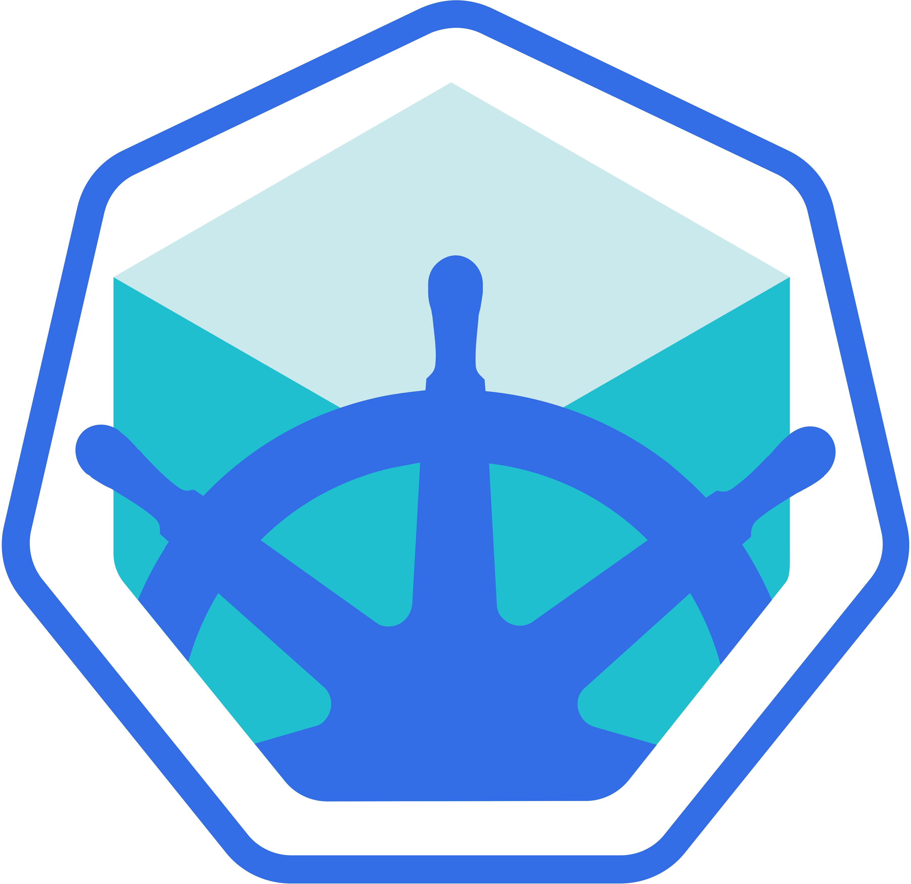

He querido enfocarme en desplegar la aplicación de **manera local** para poder entenderlo, más adelante dedicaré otro día a hacer el despliegue en la nube.

Me he centrado en algunas equivalencias entre el despliegue **en Fargate y en Kubernetes**:
Lo más parecido a la **definición de la tarea de Fargate** —> Lo escribiremos en un **Pod template** dentro de un deployment.yaml.
Para gestionar la configuración de la aplicación utilizaremos un **ConfigMap** para los datos no sensibles y un Secret para las credenciales y otros datos sensibles.
Me ha quedado claro que **es bastante diferente por mucho que quisiera encontrarle similitudes**.

**Un despliegue en Kubernetes consta de unas partes básicas**:

1. El **Pod**: Éste **es el responsable** de correr uno o más contenedores y permite que éstos compartan recursos, almacenamiento o configuración. Un pod es lo mínimo que se puede desplegar, ya que los contenedores se ejecutan dentro de él.
2. El **deployment**: Es un recurso de Kubernetes que **gestiona ReplicaSets**, que éstos gestionan los Pods. Dónde se define qué imagen usar (en local, la de docker local que creemos y en el caso de la nube, la que subamos y usemos desde ECR), se define cuántas réplicas y si queremos también los límites de recursos que tendrán. El archivo 'deployment.yaml' es el manifiesto con el que lo definimos.
3. El **ConfigMap**: Que almacena configuración no sensible como es el caso de la región de AWS que usa nuestro bucket.
4. El **secret**: Que guarda **información confidencial** para que Kubernetes la ponga a disposición del contenedor. En el caso que lo he usado yo, además lo complementaré con SSM Parameter Store y external-secret, ya explicaré más adelante el porqué.

Para hacer todo el proceso de despliegue en local necesitamos:

**· Kubectl**, que es la interfaz de comandos de k8s.

**· Minikube**, que es el clúster k8s local donde desplegaremos el Gestor S3

**· Helm**, el gestor de paquetes de k8s.

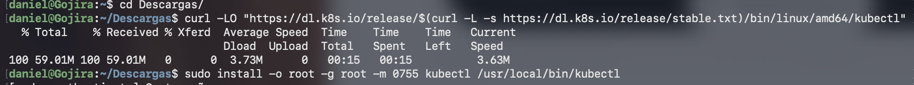

Los vamos a ir instalando desde sus repositorios oficiales que los iremos encontrando en sus páginas web respectivas.
1. [Minikube](https://minikube.sigs.k8s.io/docs/start/?arch=%2Flinux%2Fx86-64%2Fstable%2Fbinary+download)
2. [Kubectl](https://kubernetes.io/docs/tasks/tools/install-kubectl-linux/)
3. [Helm](https://helm.sh/docs/intro/install/)

Una vez instalado ya podemos poner a funcionar el clúster local con el comando 'minikube start'.

## 2. Seguridad y Gestión de Secretos (AWS SSM + External Secrets Operator)

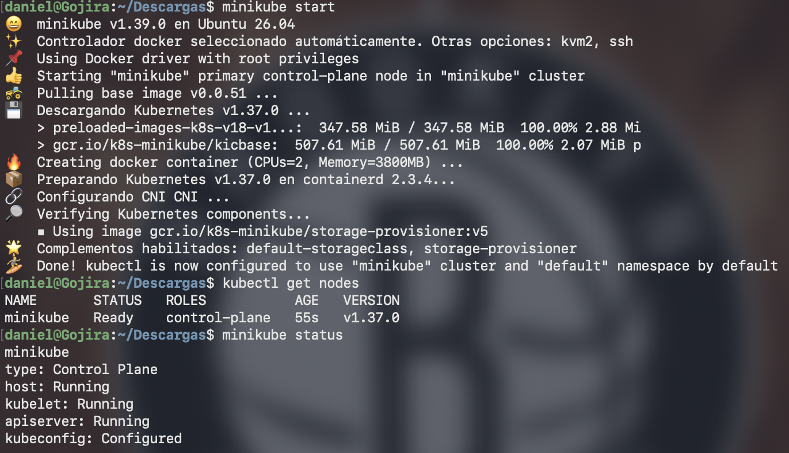

Para realizar este proceso voy a instalarle **External Secrets Operator**. Es un **operador de Kubernetes** que sincroniza los secretos de sistemas externos como son **AWS Secrets Manager**, **Google Secrets Manager**, **Azure Key Vault** o **AWS SSM Parameter Store** entre otros. Lo instalamos a través de Helm y sus CRDs correspondientes:
```bash
helm repo add external-secrets https://charts.external-secrets.io
helm repo update
helm install external-secrets external-secrets/external-secrets -n external-secrets --create-namespace --set installCRDs=true
```
Como **he dicho** antes en 'configmap.yaml', pondremos la configuración no sensible. Como son el **nombre del bucket** y la **región** de donde esta situado.

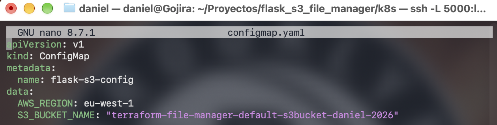

**Nota sobre el diseño**: Va a parecer un rodeo innecesario en desarrollo local, pero subimos las credenciales de infraestructura a AWS SSM Parameter Store y a su vez creamos un Secreto local de Kubernetes (acordarse siempre de **no guardar credenciales reales** en archivos YAML versionados ni subirlos a Git)
**¿Para qué?** Para que External Secrets Operator tenga permiso de entrada para conectarse a AWS, descargarse los secretos de la aplicación y crear el secreto definitivo en Kubernetes ('flask-credenciales') que consumirá nuestro **Gestor S3 con boto3**.
Hago este puente en local desde el primer día para cuando cambiemos hacia el entorno EKS y dejar el terreno listo para migrar limpiamente a **IRSA en la nube** en el futuro, evitando usar credenciales estáticas para el operador. Y ya adaptaremos en su momento a los mecanismos de identidad y permisos de EKS.

Entonces algo importante es que el usuario con el que trabajamos **tenga los permisos necesarios** de AWS SSM Parameter Store. Como utilizaremos parámetros 'SecureString' y al no especificar una clave KMS propia, AWS usa normalmente la clave gestionada por defecto de 'Parameter Store' (aws/ssm). Si utilizamos una clave propia, tendremos que revisar los permisos de KMS.

**Creamos los parámetros** que contienen las claves con las órdenes siguientes:
```bash
aws ssm put-parameter \
    --name "/flask-s3/AWS_ACCESS_KEY_ID" \
    --type "SecureString" \
    --value "TU_ACCESS_KEY_REAL" \
    --overwrite

aws ssm put-parameter \
    --name "/flask-s3/AWS_SECRET_ACCESS_KEY" \
    --type "SecureString" \
    --value "TU_SECRET_ACCESS_REAL" \
    --overwrite
```
Para que External Secrets Operator **pueda acceder a AWS**, necesitamos proporcionarle unas credenciales con los permisos necesarios. Para ello, creamos un Secret de Kubernetes llamado 'credenciales-aws', que contiene AWS_ACCESS_KEY_ID y AWS_SECRET_ACCESS_KEY.


Inicialmente lo definí mediante un archivo YAML ('aws-credentials.yaml'), pero durante las pruebas encontré un problema: las credenciales parecían contener algún **carácter invisible** que impedía la autenticación con AWS. Para solucionarlo, eliminé el Secreto anterior ('kubectl delete externalsecret flask-secret') y lo volví a crear desde la terminal:
```bash
kubectl create secret generic credenciales-aws \
 --from-literal=AWS_ACCESS_KEY_ID="TU_ACCESS_KEY_REAL" \
 --from-literal=AWS_SECRET_ACCESS_KEY="TU_SECRET_KEY_REAL"
```
De esta manera **regeneramos el Secreto** con las credenciales correctas, que después utilizará External Secrets Operator **para autenticarse en AWS** y consultará los parámetros almacenados en SSM Parameter Store.
Para configurar la conexión con el servicio de SSM, creamos el archivo 'secrets.yaml', donde definimos el SecretStore:

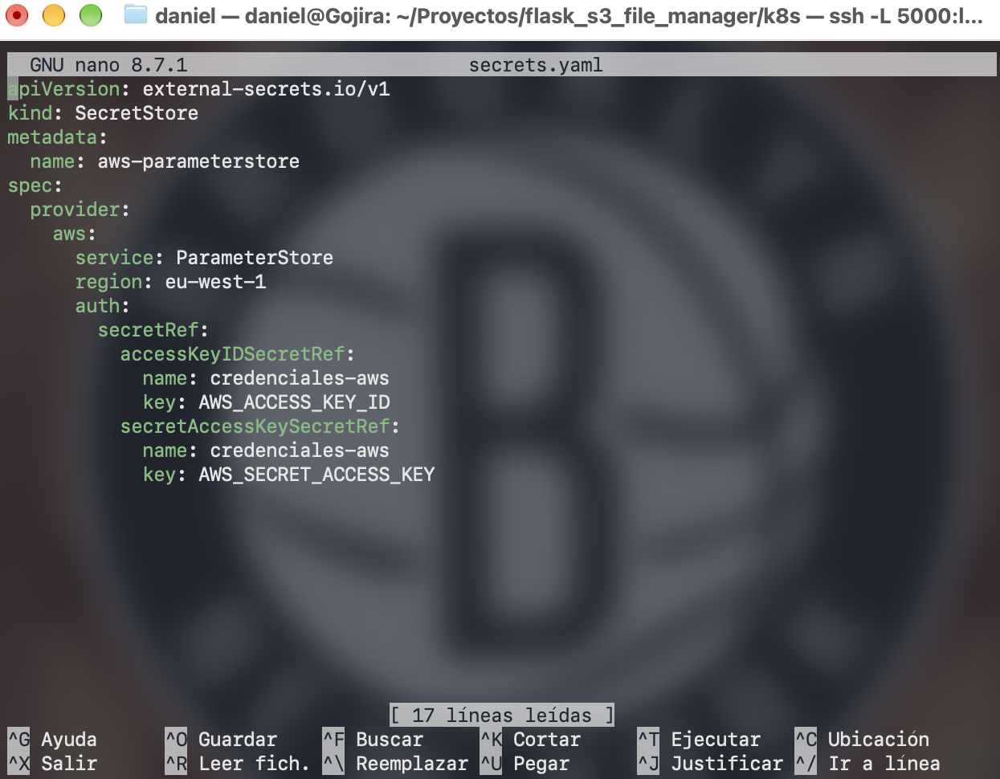

A continuación, creamos 'external-secrets.yaml', para indicar qué parametros irán de SSM al secreto final de 'flask-credenciales' que utilizará nuestra aplicación:

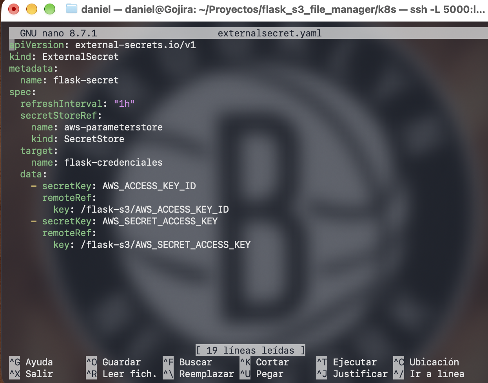

Para comprobar el estado de los Pods de ESO: 'kubectl get pods -n external-secrets'.
Después, aplicamos estos external-secrets a la configuración del Minikube: 'kubectl apply -f externalsecret.yaml'

## 3. Despliegue y Acceso Remoto

Ahora tenía que dockerizar el Gestor de S3 que tenía de manera local, **me di cuenta de algo** y es que como cambié de rama en Git ('git checkout -b kubernetes-migration') para no tocar nada de las otras que funcionaban correctamente y las tenía para otras funciones, la aplicación no correspondía a la última versión que adapté para ECS Fargate para que funcionase para producción ni tenía el mismo archivo requirements.txt, así que tuve que ejecutar el comando:
```bash
git checkout feature/terraform-aws-migration -- app/ requirements.txt Dockerfile
```

Con este recuperé las partes que consideraba necesarias de la otra rama de Git.
Construimos nuestra imagen de Docker y le damos un nombre diferente a la que tenemos para el despliegue en Fargate.
```bash
docker build -t s3-manager-k8s .
```


**Cargamos la imagen en minikube**: 'minikube image load s3-manager-k8s:latest'.
Ahora necesitamos escribir el **Deployment** donde como he dicho antes aquí configuraremos “qué imagen usar (en local, la de **Docker local** que creemos y en el caso de la nube, la que subamos y **usemos desde ECR**), se define cuántas réplicas y los límites de recursos que tendrán.”

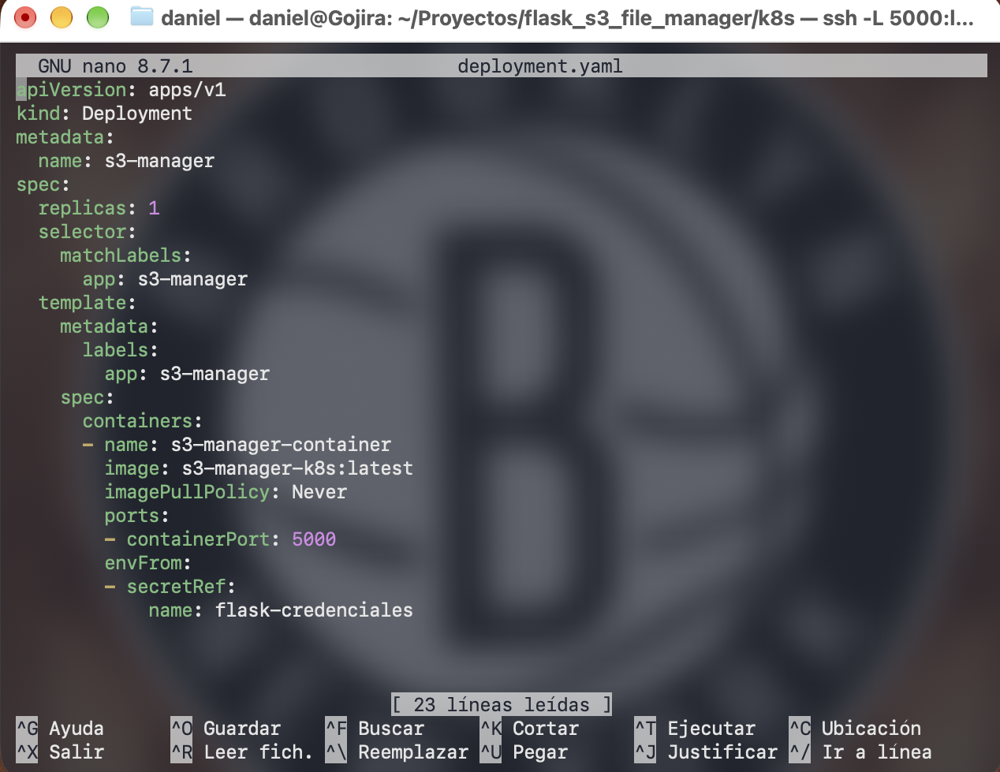

Recuerdo de nuevo que 'external-secrets' adquiere el acceso a AWS a través de 'credenciales-aws' (el secreto local que permite al operador autenticarse ante AWS) y el Gestor de S3 lo coge de 'flask-credenciales' (es el secreto que ESO genera a partir de los parámetros de SSM y consume la aplicación) que está en 'externalsecret.yaml'. Una vez tenemos preparados los manifiestos y la imagen, aplicamos el Deployment con 'kubectl apply -f deployment.yaml'. Los manifiestos **SecretStore** y **ExternalSecret** ya los hemos aplicado anteriormente.
Para ver si está funcionando correctamente: 'kubectl get pods'.

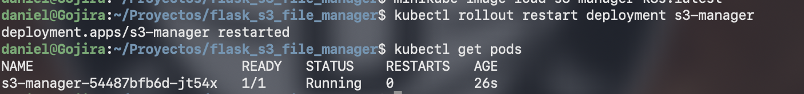

Puntualizo algo y es que como **estoy conectado vía SSH** que para poder tener acceso a la aplicación lanzada en el pod, **tenemos que exponer el puerto 5000** con 'kubectl expose deployment s3-manager --port=5000 --target-port=5000' (Este crea un Service llamado 's3-manager').

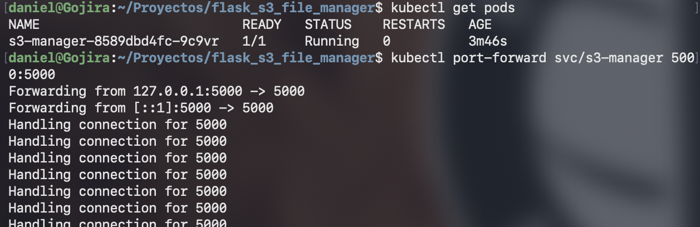

Lo **normal** para hacer una conexión SSH es usar: 'ssh usuario@ip_servidor', como he hecho siempre hasta ahora, pero para la conexión que debemos establecer ahora no nos sirve ya que nos encontramos con un **problema**, si levantamos la aplicación en el puerto 5000 en el servidor con Ubuntu, esa aplicación vive dentro de la red del servidor y en el caso de poner 'http://localhost:5000', **no funcionará**, porque nuestro macOS no tiene ni idea de qué hay en ese puerto del servidor remoto. Nuestra conexión ssh al servidor debe de ser: 'ssh -L 5000:localhost:5000 nombre_usuario@IP_servidor', este abre la terminal en el servidor remoto como el anterior pero además "construye" **un túnel cifrado** entre un puerto del macOS y un puerto del servidor, en el comando se lee: '-L [puerto_local]:[destino_remoto]:[puerto_remoto]', haciendo que todo lo que llegue a mi puerto 5000 de mi ordenador local, se mande a través del túnel y se entregue en el puerto 5000 de ese servidor remoto. Por eso **es necesario** el -L.

Para poder abrir la aplicación del pod en nuestro navegador: 'kubectl port-forward svc/s3-manager 5000:5000' (Este establece el reenvío temporal del puerto hacia un **Service**, en este caso el que hemos creado), **es necesario mantener ejecutándose el comando** _port-forward_ mientras usamos la aplicación, además de mantener activa la conexión SSH con el túnel. Este salva la distancia en el servidor remoto y lo conecta con el Service del clúster de Minikube.

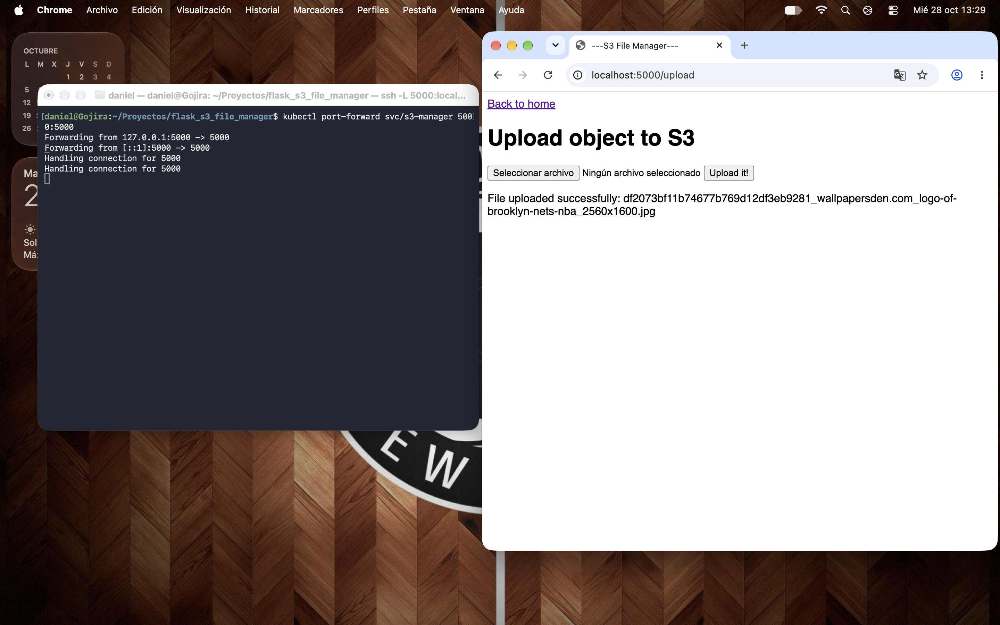
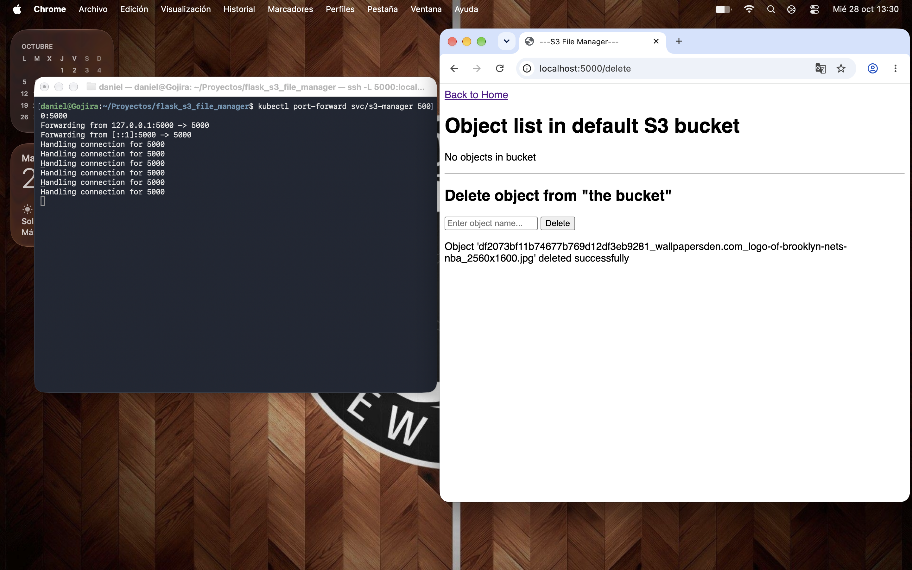

Abrimos nuestro navegador y ponemos 'http://localhost:5000' y **ya debería ser accesible**.
