# Despliegue automatizado de aplicación Flask en ECS Fargate con Terraform


Esta es la documentación técnica completa del ciclo de vida de migración y automatización de una aplicación web **Flask** con integración a **AWS S3**, desde el entorno local hasta un entorno serverless en la nube utilizando **Terraform**, **Docker**, **AWS ECR** y **AWS ECS Fargate**.

## Arquitectura y tecnologías


* **Backend:** Python, Flask, Gunicorn, 'boto3'.
* **Contenedores:** Docker, AWS ECR.
* **Infraestructura como Código (IaC):** Terraform
* **Orquestación y Red** AWS ECS Fargate, VPC, subredes, grupos de seguridad, S3, IAM.

## Comandos rápidos de despliegue

```bash
# 1. Autenticación y push a ECR
aws ecr get-login-password --region <REGION> | docker login --username AWS --password-stdin <AWS_ACCOUNT_ID>.dkr.ecr.<REGION>.amazon.com
docker build -t flask-app .
docker tag flask-app:latest <URL_ECR>:latest
docker push <URL_ECR>:latest

# 2. Desplegar infraestructura
cd terraform/
terraform init
terraform apply

# 3. Obtener IP pública del contenedor
aws ecs list-tasks --cluster flask-app-cluster --query "taskArns[0]" --output text
aws ecs describe-tasks --cluster flask-app-cluster --tasks <TASK_ARN> --query "tasks[0].attachments[0].details[?name=='networkInterfaceId'].value" --output text
aws ec2 describe-network-interfaces --network-interface-ids <ENI_ID> --query "NetworkInterfaces[0].Association.PublicIp" --output text
```

## Bitácora de despliegue paso a paso (Índice)

- [Parte 1: Contenedorización de nuestro gestor de S3](#parte-1-contenedorizacion-de-nuestro-gestor-s3)
- [Parte 2: Paso del gestor de S3 a IaC con Terraform](#parte-2-paso-del-gestor-de-s3-a-iac-con-terraform)
- [Parte 3: Publicación y alojamiento de la imagen de Docker en Amazon ECR](#parte-3-publicacion-y-alojamiento-de-la-imagen-de-docker-en-amazon-ecr)
- [Parte 4: Configuración de IAM y definición de las tareas en ECS](#parte-4-configuracion-de-iam-y-definicion-de-las-tareas-en-ecs)
- [Parte 5: Despliegue del servicio en Fargate, redes y resolución de problemas](#parte-5-despliegue-del-servicio-en-fargate-redes-y-resolucion-de-problemas)

## Limpieza del entorno
```bash
terraform destroy
```
---

## Parte 1: Contenedorización de nuestro gestor de S3
Buenas tardes a todos. Después de un tiempo liado con temas de AWS, retomo el blog para rescatar el gestor de S3 con boto3 que creé y que esta vez lo contenedorizaremos (lo convertiremos en un contenedor de Docker).


Como hemos cambiado varias veces de SO me aseguro de que el gestor continua funcionando correctamente. En mi carpeta de Proyectos he clonado desde mi cuenta de Github el [código](https://github.com/ortizens9/flask_s3_file_manager) que escribí.


Activamos el entorno, actualizamos las dependencias con el archivo requirements.txt y la ponemos en marcha con:
```bash
flask run --host=0.0.0.0 --port=5000
```
Nos muestra dos IP, depende desde donde la estemos ejecutando usamos una u otra. En el caso de estar probándola en la misma máquina, usaremos la que dice _127.0.0.1:5000_ (localhost) y si la ejecutamos en un servidor remoto (accediendo vía SSH), accedemos desde el navegador con la IP de la máquina (ej. _192.168.X.X:5000_).


En la imagen muestro la disposición de la estructura interna de la app con su árbol de directorios.


Pasamos a crear el Dockerfile, que es un documento de texto que se utiliza para hacer una imagen de contenedor; hacemos un _nano Dockerfile_. Y el contenido quedaría de la siguiente manera (he dejado comentarios explicando el funcionamiento interno).


Construimos la imagen del contenedor:


Para verificar si se ha creado con éxito escribimos _docker images_. Ahí deberíamos ver la imagen con el nombre _flask-s3-app_. Para poner a prueba el contenedor, arrancamos uno de prueba:


Esta solicitud en el navegador web se puede hacer tanto con _127.0.0.1_ como por _localhost_. Una vez verificado, lo paramos y eliminamos con:
```bash
docker stop prueba_flask && docker rm prueba_flask
```

Siguiente paso:
Ya tenemos empaquetada la app en un contenedor funcional. En la siguiente parte tengo pensado crear la infraestructura AWS utilizando **Terraform**.
Un detalle importante: En este contenedor todavía nos quedarían gestionar las credenciales para poder subir los archivos a los buckets de S3 (el "envoltorio" funciona pero nos queda la conexión con AWS y no podemos subir nada).
Aunque haya maneras de editar el archivo _.gitignore_ para no subir estas credenciales, no lo considero una buena práctica y preferiría usar roles IAM, evitando exponerlas.

Dejo un [enlace](https://docs.docker.com/get-started/docker-concepts/building-images/writing-a-dockerfile/) que me ha servido para crear el Dockerfile.

## Parte 2: Paso del gestor de S3 a IaC con Terraform
Parte 2:

En esta segunda parte de la serie nos acercaremos al objetivo, que es **automatizar el despliegue con IaC** (Infraestructura como Código).


Para empezar, instalamos Terraform desde sus [repositorios oficiales](https://developer.hashicorp.com/terraform/tutorials/aws-get-started/install-cli
).
Para estructurar correctamente el código de _manera limpia_, dividimos la configuración en tres archivos principales dentro de una misma carpeta: 'providers.tf', 'main.tf' y 'variables.tf'.

* **'providers.tf'**, para la conexión. Definiendo con quién habla Terraform (en este caso, AWS) y qué versión del plugin tiene que descargar.
* **'variables.tf'**, para las entradas. Definiendo parámetros que pueden cambiar como son la región, los nombres, las dimensiones de la máquina. Valores que harían difícil el despliegue si se quedaran fijos (hardcoded).
* **'main.tf'**, los recursos: Donde se encuentra la infraestructura real a crear: servidores, buckets, redes, BDs.

Separarlo de esta forma nos da la posibilidad de reutilizar la misma infraestructura en otros entornos o con diferentes nombres de bucket. Es más fácil de mantener, de la misma manera que cuando dividimos el código del gestor de S3. Aunque sea posible tenerlo todo en el mismo archivo, no es nada recomendable de cara al futuro. En proyectos más grandes, todavía se podría separar aún más.

Ubicados en la raíz del proyecto, generamos la carpeta 'terraform' y entramos en ella y le añadimos los archivos necesarios, que la estructura quedará así:


Después de definir los tres archivos, la estructura queda así:


He tenido que modificar el código del gestor de S3 para **orientarlo a un usuario final** y no tanto a un administrador root que lo gestiona todo. Así que le he dejado funciones de subir, borrar, listar y actualizar archivos nada más.
He adaptado la aplicación al nuevo bucket que hemos creado expresamente con Terraform para este proyecto, llamado 'terraform-file-manager-default-s3bucket-daniel-2026'. He limpiado también la parte de Flask eliminando las rutas de crear y listar buckets que teníamos en la versión anterior.

**Un consejo**: Tenemos que tener cuidado a la hora de cambiar todas las partes. Si se queda alguna línea antigua, seguirá conectándose al bucket antiguo. Un comando que me fue de utilidad para encontrar referencias fue: 'grep -rn' 'app.config' o buscar términos como 'test-s3' o 'file-manager' en la raíz del gestor.

Uno de los puntos fuertes del proyecto del Gestor es que al tenerlo todo bien separado (de manera modular) no me costó identificar qué tenía que cambiar. Os dejaré el resultado de [esta versión](https://github.com/ortizens9/flask_s3_file_manager/tree/feature/terraform-aws-migration) en una rama del repositorio de mi GitHub por si os es de utilidad.

Con el gestor actualizado, volvemos a crear la imagen de Docker como hicimos en la **Parte 1**.


Para probar la imagen (y como tengo el [AWS CLI](https://aws.amazon.com/es/cli/) instalado y configurado), le podemos compartir los permisos que tiene nuestro sistema local para que pueda realizar las operaciones en S3 (subir, listar, borrar...):
```bash
docker run --rm --env-file .env   -v ~/.aws:/root/.aws:ro   -p 5000:5000   flask-s3-app:latest
```
En esa orden:
* **'--rm'**: Indica que se borre el contenedor una vez parado de manera automática.
* **'--env-file .env'**: Especificamos donde se encuentra el archivo .env, donde se encuentran las variables de entorno.
* **'-v ~/.aws:/root/.aws:ro'**: Montamos la carpeta local de las credenciales de AWS en el contenedor en modo lectura (para pruebas locales).
* **'-p 5000:5000'**: Vinculamos el puerto 5000 del sistema con el contenedor.
* **'flask-s3-app:latest'**: Definimos la imagen de Docker que utilizamos.


Haré una serie de acciones con el bucket para asegurarme de que todo está en correcto funcionamiento.


Como podemos ver en las capturas, ya tenemos el Gestor adaptado para IaC y funcionando correctamente.
El siguiente paso será alojar esta imagen de Docker en [Amazon ECR](https://aws.amazon.com/es/ecr/) (Elastic Container Registry) **para poder desplegarla en una estrategia 100% automatizada** en la nube de AWS.

## Parte 3: Publicación y alojamiento de la imagen de Docker en Amazon ECR
El objetivo de hoy es **pasar la imagen de Docker a Amazon ECR** con el fin de desplegar nuestra aplicación en la nube de AWS utilizando IaC de manera automática.


Lo primero es añadir en el archivo 'main.tf', el nombre del repositorio:

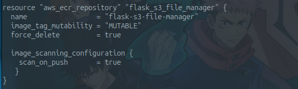

Las líneas 'force_delete' y 'scan_on_push':
* **'force_delete = true'**: Por defecto, AWS protege tus repositorios para que no borres cosas por error si tienen imágenes dentro. Pero en un entorno de aprendizaje o pruebas, si ejecutas terraform destroy sin este parámetro, AWS dará un error feo diciendo **"No se puede borrar ECR porque no está vacío"**. De esta manera, Terraform podrá eliminar el repositorio y todas las imágenes que contenga al ejecutar 'terraform destroy', sin que AWS bloquee el proceso por no estar vacío.
* **'scan_on_push = true'**: Es una buena práctica para que AWS analice si la imagen de Docker tiene vulnerabilidades conocidas al subirla.

Seguido del output que nos generará el registro ECR al desplegarlo.

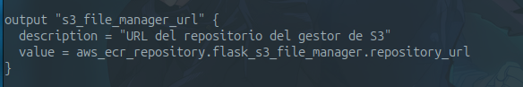

Dejo los enlaces de donde he sacado la información. [A](https://spacelift.io/blog/terraform-ecr) y [B](https://registry.terraform.io/providers/hashicorp/aws/latest/docs/resources/ecr_repository).

Después de escribirlo, ejecutamos la instrucción: 'terraform plan'.

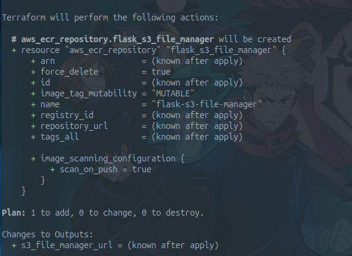
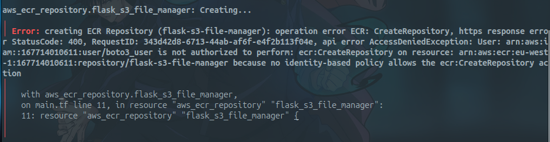

Es posible que nos encontremos con este error y es que el usuario IAM que utilizamos en la CLI (llamado 'boto3_user') únicamente tenía permisos para el control de S3; así que entramos en nuestra cuenta root de AWS, que es la que tiene la capacidad de gestionar permisos, y le damos a 'boto3_user' permisos totales sobre **ECR**.

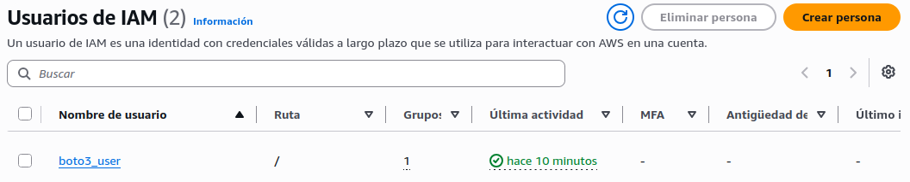
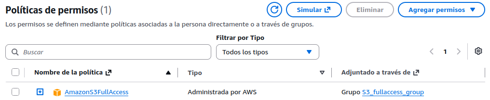
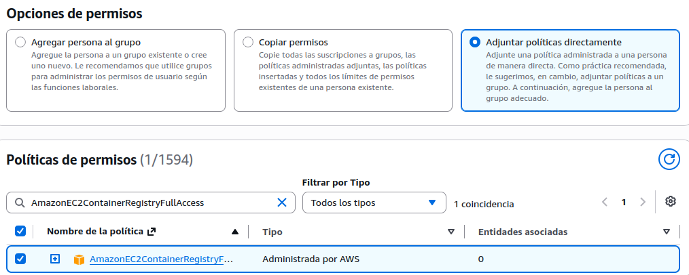

Ahora volvemos a hacer terraform plan, terraform apply y le decimos que yes.
Esto nos genera el registro con su URL, que sigue la fórmula:
```bash
aws_account_id.dkr.ecr.region.amazonaws.com/my_repository
```
Como habíamos descrito en el output del nombre del repositorio.

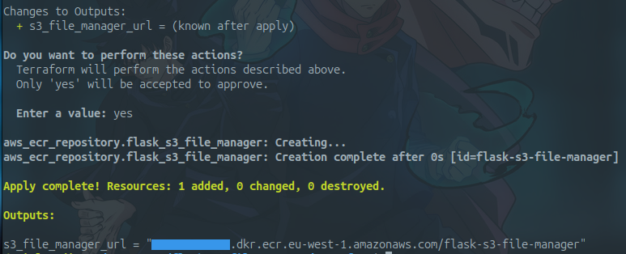

Una vez creado el registro de la imagen en ECR, solicitaremos un **token temporal** a AWS para dárselo a Docker para que este abra sesión con ECR.
ECR usa tokens que duran unas 12 horas y la CLI genera una contraseña para ti.

Solicitamos el [token](https://docs.aws.amazon.com/AmazonECR/latest/userguide/registry_auth.html) con:
```bash
aws ecr get-login-password --region region | docker login --username AWS --password-stdin aws_account_id.dkr.ecr.region.amazonaws.com
```
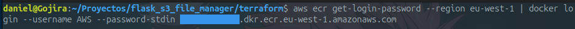
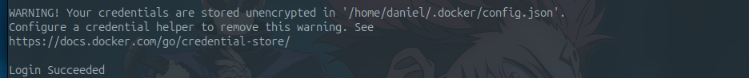

Escribimos 'docker images' para conocer el nombre de la imagen. Le ponemos un tag/una etiqueta a nuestra imagen de Docker.

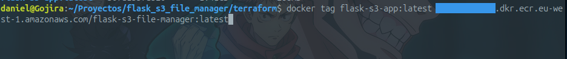

Y subimos finalmente la imagen:

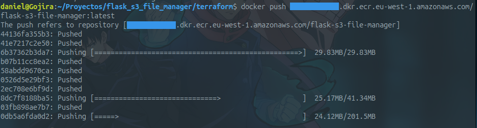

Si hacemos:
```bash
aws ecr list-images --repository-name flask-s3-file-manager --region eu-west-1
```
Veremos que se ha subido correctamente:

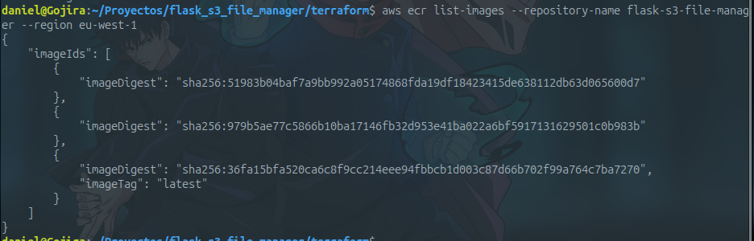

En la siguiente parte nos centraremos ya en utilizar esta imagen para lanzarla de forma automática con **ECS** y **Fargate**.


## Parte 4: Configuración de IAM y definición de las tareas en ECS
Con la imagen de nuestra aplicación ya subida a ECR, el siguiente paso es preparar la seguridad y la definición de la tarea que se ejecutará en ECS.


Primero creamos una política personalizada de S3 utilizando el AWS Policy Generator. Para que la política gestione correctamente los accesos, separamos en dos 'statements':

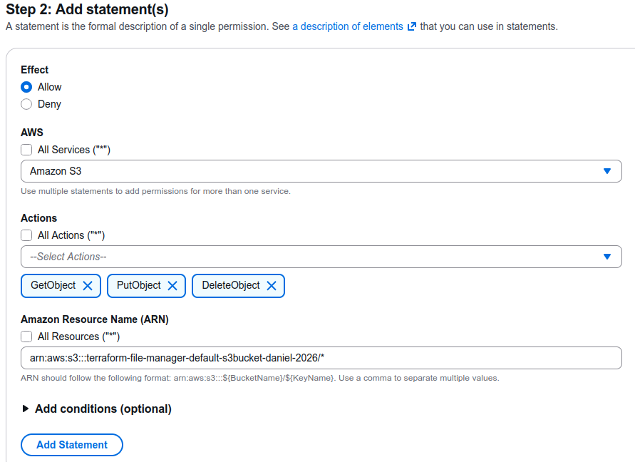
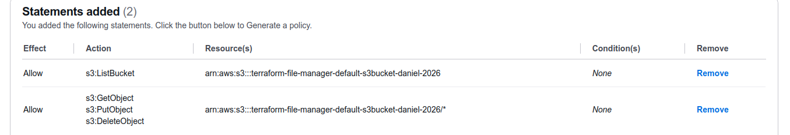

* **Uno sin asterisco** ('arn:aws:s3:::el-bucket') para referirnos al bucket de S3 como un recurso.
* **Otro con asterisco** ('arn:aws:s3:::el-bucket/*') para referirnos a todos los objetos contenidos dentro del bucket.

Una vez generada la política, es mejor operativamente pasarla a HCL que es un lenguaje para definir IaC (Infraestructura como Código). JSON y HCL comparten las mismas estructuras de datos (clave-valor, listas, cadenas, números y booleanos). HCL aporta ventajas cuando escribimos código:

1- No se usan comillas en las claves

2- Se utiliza '=' en lugar de ':'

3- No son necesarias las comas al saltar de línea

4- HCL *permite añadir* comentarios al código, algo que JSON no soporta

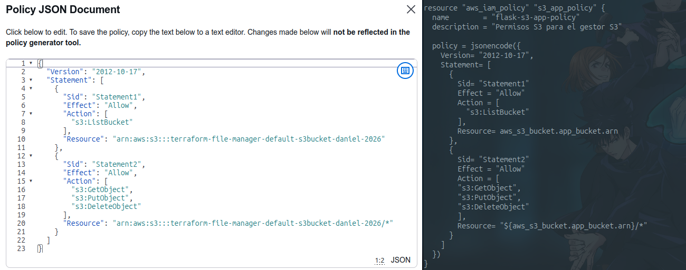

Esta política definirá qué acciones concretas puede realizar sobre el bucket de S3.

Para ejecutar contenedores en Fargate sin gestionar servidores ni perfiles de instancia EC2, necesitamos definir dos roles diferentes:

* **_'ecs_task_role'_** (Rol de tarea), que concede permisos a la aplicación en ejecución. Le dará a nuestro código Flask los permisos para utilizar otros servicios de AWS. Aportará al Gestor (ya en la nube de AWS) los permisos necesarios en el código para poder listar, subir y borrar archivos dentro del bucket de S3. Su funcionamiento es: tu código Flask -> Operaciones en S3.

Le añadimos una política de confianza (assume_role_policy) al servicio 'ecs-tasks.amazonaws.com'.

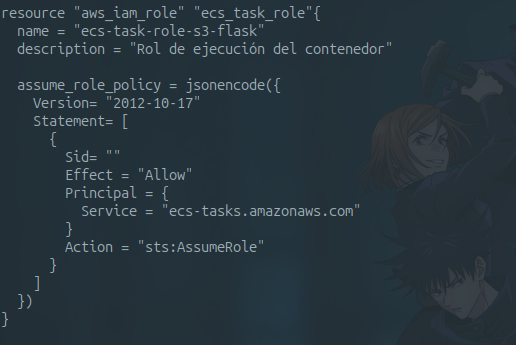

En lugar de asignar una política al recurso de forma fija, creamos un 'attachment'. Eso nos dará unos puntos a favor: Como son el desacoplamiento y la modularidad: Si en el futuro lo destruimos y lo modificamos, no hace falta volver a desplegar el rol. Además, podemos reutilizar el mismo en otros servicios (como en una función Lambda) y aplicar permisos de forma progresiva, respetando el **principio del mínimo privilegio**.

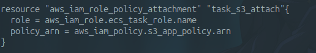

* **_'ecs_execution_role'_** (Rol de ejecución), este rol le da al agente de Fargate/de ECS permiso a nivel de infraestructura para poder autenticarse en ECS, descargar la imagen de Docker y enviar los logs a CloudWatch (Agente Fargate -> ECR + CloudWatch). Este rol también tiene su política de confianza y en el 'attachment' se le adjunta la política (AmazonECSTaskExecutionRolePolicy) que es administrada por AWS, que permitirá a ECS descargar la imagen desde ECR y enviar los logs a CloudWatch.

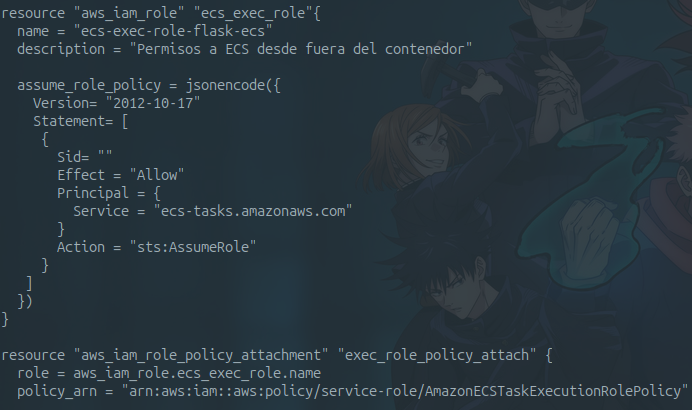

A continuación definimos la tarea 'aws_ecs_task_definition' dentro de nuestro main.tf:
* Definimos: La familia de la tarea, el modo de red 'awsvpc', la compatibilidad FARGATE, la CPU y la memoria asignadas
* Vinculamos el ARN de los roles que hemos creado ('Task Role' y 'Execution Role')
* Definimos el contenedor indicando la URL dinámica de ECR, la etiqueta :latest y mapeamos el puerto 5000

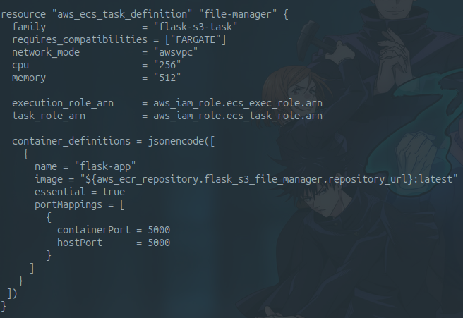

En la siguiente parte configuraremos la red (VPC, subredes y Grupos de Seguridad), *desplegaremos el servicio y resolveremos los problemas reales* que surgieron durante la puesta en marcha.

## Parte 5: Despliegue del servicio en Fargate, redes y resolución de problemas
